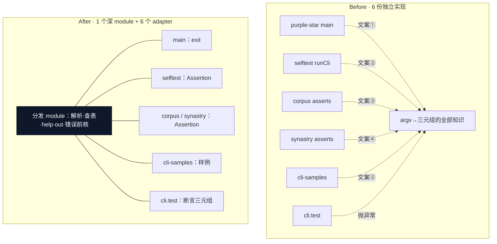
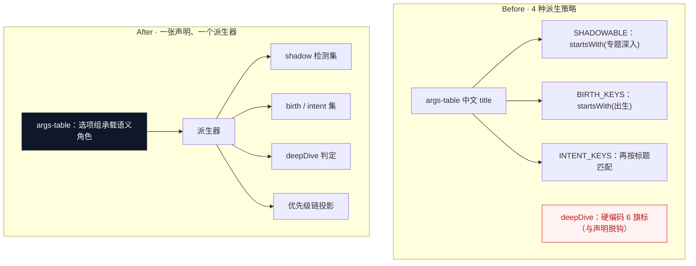
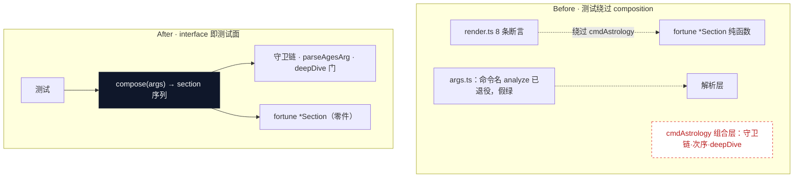
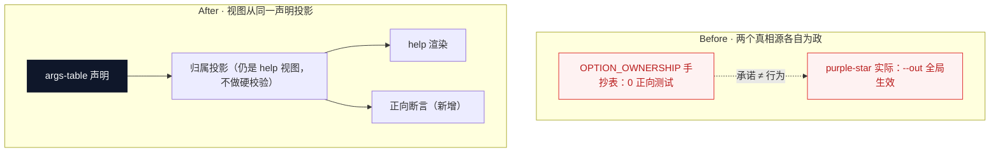
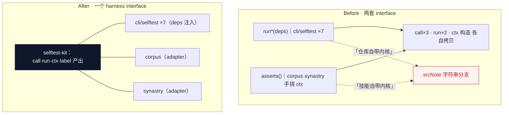
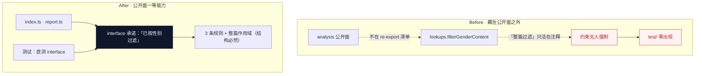

# 架构深化审查（2026-10-11）

> 流程：improve-codebase-architecture + codebase-design 词汇表。
> 热点依据近 80 次提交（集中于 `scripts/cli/`）；已排除 2026-10-01 架构评审（8 候选全实施）与
> `structure-review-20261011.md`（候选 1/2 落地、3 挂起、4/5 记录、点名不动的整文件级重排）覆盖的项。
> 判定以 CLAUDE.md 的刻意设计清单为准（晚子时双口径、绊线字段、引导层铁律、OPTION_OWNERSHIP 只做视图等不作摩擦项）。
> 仓库无 GLOSSARY.md、无 ADR。术语遵循 codebase-design：module · interface · implementation · depth · seam · adapter · leverage · locality。

---

## 候选 1 · 把「跑一条命令」的分发协议收成一个 module　【Strong · ports & adapters】

**涉及文件**

- `scripts/purple-star.ts`（main 271–326：--help 拦截 276–291、--out 通道 316–319、未知命令 306）
- `scripts/cli/selftest.ts`（90–107：runCli / call）
- `scripts/corpus/selftest-asserts.ts`（42–60）、`scripts/synastry/selftest-asserts.ts`（155–163）
- `tools/cli-samples.ts`（934–974）、`test/cli.test.ts`（84–162）

**Problem**　argv → `{code, out, err}` 这一个概念有 **6 份独立实现**；`未知命令「x」` 文案有 **5 种变体**，`错误：` 前缀至少 5 份拷贝；`--help` 拦截与 `--out` 通道只存在于 main 里，没有任何 harness 能经由同一 seam 触到它们——`test/cli.test.ts:1841` 自认「进程内快捷路径不覆盖它」，`selftest/guard.ts` 不得不用 5 条真子进程冒烟来兜。

**Solution**　把「解析 → 查命令表 → help 拦截 → 执行 → out 落盘 → 错误前缀 + 退出码」整条链沉成一个深 module，interface 只表达「给 argv 与上下文，拿三元组」；6 个调用点各自退化为该 seam 上的 adapter（写 stderr / 收进 Assertion / 渲染样例 / 断言）。

**Before → After**



**Wins**

- deletion test 通过：复杂度散落 6 处
- locality：文案一处真相源
- `--help` / `--out` 进程内可直测
- 5 条子进程冒烟可收缩
- 错误前缀删 5 份拷贝

---

## 候选 2 · 独占分支与专题语义收成一张声明　【Strong · in-process】

**涉及文件**：`scripts/cli/astrology.ts`（SHADOWABLE 279–289 / BIRTH_KEYS 296–298 / INTENT_KEYS 307–311 / deepDive 585–591 / 优先级链字面量 358、442）；`scripts/cli/command-meta.ts:36`、`scripts/cli/selftest/guard.ts:155`（同一优先级链字符串再抄两处）

**Problem**　「哪些参数属于独占分支 / 出生日 / 意图 / 专题深入」在**一个文件里**用 4 种互不相通的方式派生：前三处靠 `OPTION_GROUPS` 中文 display title 的 `startsWith` 字符串匹配，第四处（deepDive）硬编码 6 个旗标、与声明完全脱钩。改一个 help 标题就静默拆掉 zero-input demo 与 shadow 检测（现有唯一断言只查「标题后跟参数行」，不建语义绑定）；往声明表新增专题旗标，deepDive 不认，overview 面板错配出现。

**Solution**　让声明表的选项组**承载**语义角色（而非靠标题字符串反推），四套派生与 deepDive 从同一声明导出；优先级链成为该声明的一个投影，astrology 各分支入口只消费派生结果。

**Before → After**



**Wins**

- locality：4 种策略 → 1 张声明
- 改 help 标题不再拆检测
- 新专题旗标自动进 deepDive
- 优先级链 4 处字面量 → 1 处投影
- 标题↔语义绑定变成可直测断言

---

## 候选 3 · 专题旗标 → section 的接线升为测试面　【Strong · in-process】（与候选 1 同链）

**涉及文件**

- `scripts/cli/astrology.ts`（603–639 接线 + 604–620 守卫链）
- `scripts/cli/selftest/render.ts`（128–237：8 条 section 直调断言）
- `scripts/cli/selftest/args.ts`（82、106、119、123–127：使用已退役命令名 `"analyze"`，假绿）
- `test/cli.test.ts`

**Problem**　真正会出 bug 的组合层（旗标→section 映射、`parseAgesArg` 包裹、deepDive 门、`--monthly`→`--mutagen`→`--daily`→`--hourly` 守卫链、section 次序）零端到端覆盖：8 条专题断言完全不经 `cmdAstrology`，直接调 fortune 导出配手搓 chart；**`--decadal` 与 `--ages` 在 selftest 与 test 里没有任何一条真跑的用例**（唯一真跑它们的是文档生成器 cli-samples）。这正是「interface 不是测试面」的教科书案例——测试必须绕过 composition 才能测，说明 composition 的形状不对。

**Solution**　把「给定一组 args，产出 section 序列」提升为可直调的 interface，让接线本身成为被测物；fortune 各 `*Section` 退为 implementation 零件，守卫链与包裹逻辑沉进同一实现。

**Before → After**



**Wins**

- locality：`--decadal` / `--ages` 覆盖缺口自动闭合
- 退役命令名假绿从测试面消失
- 守卫链 · 次序 · deepDive 一处归位
- 测试不再复刻打包逻辑

---

## 候选 4 · 归属表从转录改为投影　【Strong · local-substitutable】（与候选 2 同源）

**涉及文件**

- `scripts/cli/help.ts`（OPTION_OWNERSHIP 26–47，唯一消费点 248）
- `scripts/cli/args-table.ts`、`scripts/cli/args.ts`（146–148 既有决策）
- `scripts/purple-star.ts`（316–319：`--out` 实际对每条命令生效）
- `scripts/cli/selftest/commands.ts`（619–631：仅两条负向抽查）

**Problem**　「哪个参数归哪条命令」是手抄的第二真相源（`Record<CommandName, readonly string[]>`），全仓唯一消费者、**零正向测试**；漂移已经发生：`--out` 只登记在 astrology 名下，但 main 对每条命令都尊重它——`knowledge --out f` 能用却无处可查；`--config` / `--template` 只被 cmdAstrology 读取，却对其它命令静默接受。

**Solution**　让归属表成为声明表的一个**视图投影**（该文档已接受「视图」定位，此处只把数据来源从手抄改为派生），消费面仍是 help 渲染；给投影一条正向断言。

**Before → After**



**Wins**

- locality：转录 → 投影，漂移不可能
- `--out` 全局性一处声明
- 归属正向断言可直测

> ⚠️ **不推翻 `args.ts:146` 的既有决策**——归属仍是 help 视图、不做硬校验；改的只是数据从手抄改为派生。

---

## 候选 5 · 断言组 interface 统一，消灭 rootLabel 分叉　【Worth exploring · in-process / mock】

**涉及文件**

- `scripts/cli/selftest.ts`（90、97、111–138 的 27 个 `run*(deps)` 硬序列表、162 `srcNote`）
- `scripts/cli/selftest-kit.ts`、`scripts/corpus/selftest-asserts.ts`（42–61）、`scripts/synastry/selftest-asserts.ts`（155–163）
- `scripts/purple-star.ts:115`、`test/lib/loader.ts:42`、`tools/cli-samples.ts:51`（label 分叉处）

**Problem**　两套断言组 interface 并存：`run*(deps)`（cli/selftest/ 7 文件）与 `asserts()`（corpus / synastry，各自**手搓 ctx** 并硬写 `rootLabel: "技能自带内核"`——设了 `ZIWEI_ROOT` 时该标签就是错的）；`call` 闭包 3 份、子进程 `run` 2 份。全仓 label 已分叉成两个字面量，而 `selftest.ts:162` 恰恰对该字符串做 `===` 分支决定 srcNote。另有 27 个 `run*(deps)` 调用硬序手写。

**Solution**　把「断言组 = 拿 deps → 吐 Assertion[]」收成一个 interface（corpus/synastry 的 `asserts` 成为注入 `SelftestDeps` 的 adapter），ctx 与 root/rootLabel 构造沉进 selftest-kit，label 由构造点产出。

**Before → After**



**Wins**

- locality：call/run/ctx 5 份拷贝归一
- rootLabel 真相源一处
- 断言组可注入假 deps 直测
- 27 个硬序调用收进组清单

---

## 候选 6 · 口径提示 basis 的 6 种重打包收成一处　【Worth exploring · in-process】

**涉及文件**

- `scripts/cli/birth-info-defs.ts`（109–126：BirthInfoResult 9 扁平字段）
- `scripts/cli/astrology.ts`（399–400 解构 9 变量；450/451/475/476/579/580/595/596 重打包；160–171 JSON basis）
- `scripts/cli/report.ts`（99–102、129–130）、`scripts/cli/render.ts`（112、309）、`scripts/cli/fortune.ts`（204 + 181 InfoClockOpts）
- `scripts/synastry/chart-view.ts:229`（消费端自造第 6 种形状）

**Problem**　9 个扁平字段（`note` 标注为「notes 的其中一项」、`longitude` 与 `info.longitude` 同值——同一事实重复承载）在约 175 行里被重新打包成 **6 种形状**：两对 section 永远成对出现却要传 2+2 个标量；`clockTime: typeof args.time === "string" ? ... : null` 逐字重复两遍（451、596）；JSON 与 chart-view 各内联一种。测试 `birthplaceSection` 必须先手工凑齐标量，等于在测试里复刻打包逻辑。

**Solution**　口径提示作为一个整体 interface 流经 astrology → render/report，section 收它而非散装标量；implementation 是 9 字段如何折算出生地 / 晚子 / 时钟三种投影，集中在一处。

**Before → After**

```text
Before                                   After
──────                                   ─────
BirthInfoResult 9 字段                   ┌─────────────────────────┐
  │ 解构为 9 个局部变量                   │ 口径提示 basis（interface）│
  ├─→ birthplace+lateZi：2+2 标量 ×3 处   │ implementation：9 字段      │
  ├─→ infoSection：{clockTime,…} ×2      │ → 三种投影                 │
  ├─→ buildReport：第 4 种形状            └───────────┬─────────────┘
  ├─→ buildAnalyzeJson：第 5 种                      │ 一个 basis
  └─→ chart-view：第 6 种 {note,notes}        ┌───────┼───────┐
                                              出生地   晚子   时钟
                                        → render sections / report / JSON
```

**Wins**

- locality：6 种形状 → 1 个 basis
- clockTime 重复计算消失
- 打包对错成实现内部事务
- 测试不再复刻打包逻辑

---

## 候选 7 · 性别过滤上 analysis 公开面，给它一个测试面　【Worth exploring · local-substitutable】

**涉及文件**

- `scripts/analysis/lookups.ts`（28–78：filterGenderContent，50 行 3 条规则）
- `scripts/analysis/index.ts`（99–102 口径注释、126 调用、135 公开面 re-export）
- `scripts/analysis/report.ts`（347 第二次调用）

**Problem**　性别过滤是 analysis 公开语义的一部分（`getTopicAnalysis` 返回值已按性别过滤），却**不在公开面上**（135 行只 re-export 4 个符号），「必须作用于拼接后整篇」这条规则只以注释存在；`test/` 里 `filterGenderContent` / `女命` / `男命` **零出现**。测试要测它必须 import 内部模块，绕过公开面。

**Solution**　把性别过滤提升为公开面一等能力（或让「已过滤」承诺成为可断言的 interface 属性），两个调用点经同一 interface 进入——「拼接后过滤」从注释变成实现内的结构必然：只有一个入口，就不可能逐节调。

**Before → After**



**Wins**

- 测试面：3 条规则可直测
- 「整篇过滤」结构化，不靠自觉
- 调用义务从 2 处收进 1 个入口

---

## 候选 8 · 宫位查询的 5 种形状收敛为一个 module　【Speculative · in-process】

**涉及文件**

- `scripts/cli/render.ts`（72 palaceAtBranch 抛错 A / 92 mustPalace 抛错 B / 170 surroundNames）
- `scripts/patterns/helpers.ts`（340 行，**19 个导出**多为 1–2 行，6 个 detector 文件消费）
- `scripts/analysis/palace-query.ts`（按宫名）、`scripts/palace-relations.ts`（76 行，正确单点范本）

**Problem**　「找一个宫」一个概念 5 种形状、3 种失败语义（抛错 A / 抛错 B / undefined / 按宫名 / 取邻宫）；三方四正算术同时活在 `patterns/helpers`、`palace-relations`、`render.surroundNames` 三处；`patterns/helpers.ts` 的 19 个导出 interface 深度趋近零（shallow：interface 与 implementation 同复杂）。

**Solution**　把「按 branch 取宫（必得 / 可缺省两种失败语义）+ 邻宫/对宫/三方四正算术」收成一个深 module，palace-relations 的偏移算术并入 implementation；render 的两个抛错变体成为同一 interface 上的失败语义选择。宫名查找保留为另一条 seam（依赖宫名口径，不同源）；**独立预言机（invariants / year-scan）不并入**。

**Before → After**

```text
Before                                    After
──────                                    ─────
palaceAtBranch（抛错 A）                  ┌──────────────────────────────┐
mustPalace（抛错 B，异文案）               │ 取宫 module（deep）            │
getPalaceByBranch（undefined）           │ branch 查询 + 失败语义参数      │
palace-query（按宫名，另一 seam）          │ + 邻宫·三方四正算术             │
surroundNames（邻宫；算术 ×3 处重复）      └───────────┬──────────────────┘
  ↓ 5 种形状、3 种失败语义                  seam：宫名查找保留独立
                                           独立预言机不动；6 个 detector 为调用方
```

**Wins**

- deletion test：算术散落 6 个 detector
- locality：三方四正公式一处
- 失败语义参数化，不再各抛各的
- 独立预言机不并入

> ⚠️ **本清单最接近「可缓」的一项**：触碰 6 个 detector 文件，与 structure-review 对 fortune 的「挂起观察」态度一致，可等下次实质改动顺手做。

---

## 优先级速览

| # | 标题 | 强度 | 依赖类别 |
|---|------|------|----------|
| 1 | 分发协议收成一个 module | Strong | ports & adapters |
| 2 | 独占/专题语义收成一张声明 | Strong | in-process |
| 3 | 旗标→section 接线成为可测 interface | Strong | in-process |
| 4 | 归属表从转录改为投影 | Strong | local-substitutable |
| 5 | 断言组 interface 统一 + rootLabel 分叉 | Worth exploring | in-process / mock |
| 6 | 口径提示 basis 多形态收一处 | Worth exploring | in-process |
| 7 | filterGenderContent 上公开面 | Worth exploring | local-substitutable |
| 8 | 宫位查询多视图收敛 | Speculative | in-process |

**成对关系**：1 与 3 同属「测试绕过 interface」一条链（1 让 `--help`/`--out`/未知命令进程内可触达，3 让组合层可直测）；2 与 4 同源于 `args-table.ts`（一次声明深化同时养活语义派生与归属投影两个视图）。

## 首选推荐

**候选 1（分发协议收成一个 module）**——deletion test 在 6 个调用点上明确通过；把 `--help`、`--out`、未知命令从「只能起子进程才能测」变成经 interface 直测，既是候选 3 的地基，也是「交付包内自检」这条链上最大的 locality 缺口。
